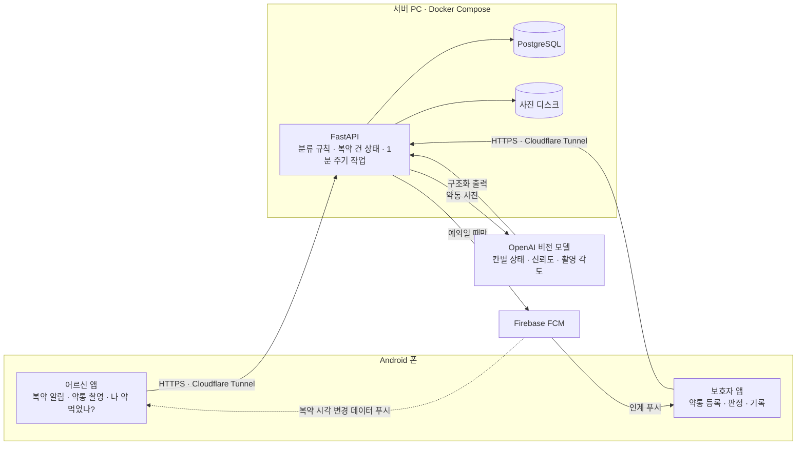

# 약, 드셨나요? · 서버와 AI 판독 (WOOWANGTHON_TEAM_21_BE)

치매 어르신 복약 확인 앱의 서버 + AI 약통 판독 모듈. 2026 AI 우왕톤 출품작.
사용자 PC에서 FastAPI 서버를 돌리고 Cloudflare Tunnel로 공개한다.

> **현재 상태:** API 계약서(DOCS 저장소 `docs/design/api.md`)의 엔드포인트를 모두 구현했다.
> 심사용 서버는 **실제 AI(OpenAI `gpt-6.1-sol`)** 로 판독한다. 설정을 주지 않으면 기본 판독기는 **모의 판독기(MockReader)** 이고, 그 결과는 `is_mock=true` 로 내려가 앱에 "모의 판독"으로 표시된다.

## 프로젝트 개요

**약, 드셨나요?** 는 따로 사는 치매 어르신의 복약을 확인하는 앱이다 (2026 AI 우왕톤 21팀, 1인 개발).

- **문제:** 치매는 최근 기억부터 잃어서, 어르신은 오늘 약을 먹었는지 스스로 기억하지 못한다. 복용 누락과 이중 복용 위험이 생기고, 지금은 보호자가 매일 연락해 약통 사진을 받아 직접 확인한다
- **하는 일:** 복약 시간에 앱이 어르신께 묻고, 어르신이 약통 사진을 찍으면 AI가 칸이 비었는지 판독한다. 정상이면 조용히 기록하고, **예외(무응답, 판독 애매, 칸이 그대로, 이중 복용 의심)만 보호자에게 넘긴다.** 최종 판정은 보호자가 한다
- **하지 않는 일:** 복용을 지시하거나 용량을 안내하지 않는다 (의료 조언 금지). 사진은 "칸이 비었다"까지만 확인하고, 삼켰는지는 확인하지 못한다
- **저장소:** 앱 `WOOWANGTHON_TEAM_21_FE`, 서버·AI 판독 `WOOWANGTHON_TEAM_21_BE`, 기획·설계 문서 `WOOWANGTHON_TEAM_21_DOCS`

## 아키텍처



복약 한 건의 흐름: 복약 시각 → 어르신 폰 알림 → 약통 사진 업로드 → AI 판독 → 서버 규칙으로 분류 → 정상은 기록, 예외는 보호자 푸시 → 보호자 판정.

이 저장소는 그림의 가운데(서버)와 판독기, 그리고 판독 정확도 검증 도구(`harness/`)다.

## 기술 설계와 선택 (ADR)

| 결정 | 고른 것 | 이유 | 감수한 것 |
|---|---|---|---|
| AI 와 규칙의 경계 | AI 는 칸마다 `full / empty / unclear`, 신뢰도, 촬영 각도만 답한다. 정상·인계는 서버 규칙이 정한다 | AI 가 틀려도 규칙은 설명할 수 있고 테스트할 수 있다. "보호자에게 넘길지"를 모델에 맡기지 않는다 (AI 는 동료, 결정은 사람) | 규칙이 늘어난다 (`app/services/classify.py`, 아래 "분류 규칙") |
| 불확실할 때 | 신뢰도 0.9 미만이거나 비스듬히 찍은 사진은 "드심"으로 기록하지 않고 다시 찍기 1회 → 그래도 애매하면 보호자 인계 | 조용히 잘못 기록되는 것이 가장 위험하다. 평가 사진 60장에서 각도 판정 없이는 조용한 오판이 15칸, 엄격한 각도 판정에서는 0칸이었다 | 제대로 찍은 사진 40장 중 7장도 다시 찍게 됐다 |
| 판독 모델 | OpenAI `gpt-6.1-sol` | 같은 사진 60장(420칸) 비교에서 값싼 `gpt-6-luna` 는 정답률은 비슷했지만(91.7% / 95.7%) 확신이 낮아, 드신 뒤의 빈 칸 중 한 번에 인정된 비율이 45.7% 였다. `sol` 은 91.9% | 사진 1장 비용이 약 18배 ($0.002 → $0.032), 응답 중앙값 8.8초 |
| 판독기 교체 | `Reader` 프로토콜 뒤에 Mock · OpenAI · Claude · Ollama | 같은 라벨 데이터로 모델을 비교하고(`harness/`), 키 없이도 개발한다 | 모의 결과가 실제처럼 보이지 않게 `is_mock` 을 끝까지 들고 다닌다 |
| 사진 크기 | (평가만 함) 긴 변 2048px 로 줄이면 정답률은 그대로이고 비용 1/3, 응답 1.7배 빠름. 1024px 는 정답률이 떨어짐 | 비용과 응답 시간 | **서버에는 아직 반영하지 않았다.** 지금은 앱이 올린 크기 그대로 보낸다 |
| 시간 관리 | 재질문·무응답 인계 시각은 서버가 잰다 (1분 주기 작업) | 어르신 폰이 꺼져 있어도 30분 뒤 보호자에게 넘어간다 | 반영이 최대 1분 늦다 |
| 기준선 | 약통의 기대 상태를 "마지막으로 채운 사진 + 그 뒤 복약 기록"으로 계산 | 이중 복용 의심(차 있어야 할 칸이 빔)과 칸이 그대로를 가려낸다. 채운 약통이 사진에 보이면 자동으로 새 기준선으로 삼는다 | 기준선이 틀리면 뒤의 판단이 함께 틀린다 → 보호자 화면에 판독 사진을 함께 보여 준다 |
| 푸시 | FCM HTTP v1 직접 발송 (서비스 계정 JWT 를 직접 서명) | 중간 서비스 없이 보내고, 실패한 토큰을 바로 지운다 | Android 만 지원 |
| 배포 | 사용자 PC + Docker Compose + Cloudflare Tunnel | 비용 없이 상시 가동, 사진이 외부 저장소로 나가지 않는다 (판독 API 호출 제외) | PC 가 꺼지면 서비스가 멈춘다 (`docs/deploy.md` 에 복구·백업) |
| 개인정보 | 사진 URL 은 5분짜리 서명 URL, 가족 단위 토큰 인증, 어르신 동의 뒤에만 기록 | 약통 사진과 복약 기록은 민감 정보다 | 판독을 위해 사진이 외부 AI 서비스(OpenAI)로 전송된다 (어르신 동의 화면에서 알린다) |

수치는 직접 찍은 약통 사진으로 `harness/` 를 돌려 얻었다. 사진과 결과 파일은 개인정보라 커밋하지 않는다.

## 확인 방법

- **자동 테스트:** `uv run pytest` (226개 통과, 2개 건너뜀. 2026-11-15)
- **API 직접 호출:** 서버를 띄우고 `/docs` 를 연다 (아래 "실행")
- **판독 정확도:** `harness/` 로 라벨 데이터를 돌린다 (아래 "판독 정확도 검증")
- **전체 흐름:** FE 저장소의 앱을 이 서버에 붙여 확인한다

## 구성

```
app/
  main.py            FastAPI 앱 (create_app 팩토리)
  routers/           API 경로 (api.md 3장)
  services/          분류·기대 상태·복약 흐름·요약
  jobs.py            1분 주기 작업
  models.py          DB 테이블
  config.py          환경 변수 설정 (.env)
  reader/            AI 판독 인터페이스
    base.py          Reader 프로토콜, Layout, CellReadings
    mock.py          MockReader (모의, is_mock=true)
    claude.py        ClaudeReader (Anthropic API, structured output)
    openai.py        OpenAIReader (GPT. 실제 판독 기본 후보, R-037)
    ollama.py        OllamaReader (로컬 모델)
    prompts.py       판독 프롬프트 초안
harness/             판독 정확도 검증
  labels.py          라벨 형식
  run.py             여러 판독기 비교 → 표
  make_samples.py    합성 샘플 생성기
  review_sheet.py    라벨 확인 시트(HTML)
  pricing.py         모델별 토큰 가격
  README.md          하네스 사용법 (로컬 모델 실행 안내 포함)
  samples/           합성 샘플 이미지와 라벨 (실제 사진 아님)
tests/
```

## 실행 (로컬)

[uv](https://docs.astral.sh/uv/) 가 필요하다.

```bash
cp .env.example .env          # 필요한 값만 채운다. .env 는 커밋하지 않는다
uv sync --extra claude        # Claude 판독기를 안 쓰면 --extra 생략
uv run uvicorn app.main:create_app --factory --reload
curl http://localhost:8000/health
```

테스트와 린트:

```bash
uv run pytest
uv run ruff check . && uv run ruff format --check .
```

## 주요 환경 변수

`.env.example` 참고. 자주 바꾸는 것:

| 변수 | 기본 | 뜻 |
|---|---|---|
| `READER_LAYOUT`, `READER_CELLS` | `mock` | 판독기 (`mock` / `claude[:모델]` / `openai[:모델]` / `ollama[:모델]`) |
| `OPENAI_API_KEY`, `OPENAI_MODEL` | (비움), `gpt-6-luna` | GPT 판독기. 키가 없으면 서버는 뜨고 모든 판독이 애매(재촬영 → 인계)로 처리된다. 심사용 서버는 `.env` 에서 `gpt-6.1-sol` 을 쓴다 |
| `DAILY_READING_LIMIT` | `0` | 가족당 하루 판독 횟수 한도. `0` 이면 제한 없음. 비용을 막으려면 양수로 둔다 |
| `OPENAI_REASONING_EFFORT` | (비움) | GPT 추론 강도. 비우면 모델 기본값. 낮추면 빨라지지만 시험에서 '약 있는데 빈 칸' 쪽 불일치가 늘었다 |
| `PUBLIC_BASE_URL` | (비움) | 앱에 내려주는 사진 URL 앞부분 (Cloudflare Tunnel 주소) |
| `JOBS_ENABLED` | `true` | 1분마다 복약 건 열기·무응답 인계·요약 푸시·사진 정리 |
| `EXPO_PUSH_ENABLED` | `false` | 보호자 푸시 실제 발송. 끄면 로그만 남긴다 |
| `DEMO_MODE` | `false` | 시연 트리거 `POST /api/v1/dev/dose-events` 와 시연 초기화 `POST /api/v1/dev/reset` (데모 가족만. 초기화는 그 가족의 복약 기록·인계·복약 사진을 지우고 연결·약통·일정은 남긴다). 심사용 서버에서만 켠다 |

API 문서는 서버를 띄운 뒤 `/docs` 에서도 볼 수 있다.

## 실행 (Docker Compose)

상시 가동, Cloudflare Tunnel 연결, 재부팅 복구, 업타임 모니터, 백업, 데모 가족은 [docs/deploy.md](docs/deploy.md) 참고.

```bash
cp .env.example .env
docker compose up -d --build            # api + db
docker compose --profile ollama up -d   # 로컬 판독 모델까지 (선택, NVIDIA GPU)
```

`api` 는 `127.0.0.1:8000` 에만 열린다. 외부 공개는 Cloudflare Tunnel 이 이 포트로 연결해서 한다.

## 판독 정확도 검증

같은 라벨 데이터로 여러 판독기를 돌려 칸 단위 정확도, 애매 비율, 지연을 표로 낸다.

```bash
# 합성 샘플 + 모의 판독기로 동작 확인
uv run python -m harness.run --labels harness/samples/labels.json --readers mock

# 실제 사진으로 비교 (키·서버가 없는 판독기는 건너뜀)
uv run python -m harness.run --labels harness/data/real/labels.json \
  --readers mock,claude:claude-haiku-5-5,claude:claude-sonnet-5-5,ollama:qwen2.5vl:7b \
  --layout --thresholds 0.7,0.8,0.9 --out-dir harness/results
```

- 라벨 형식은 `harness/labels.py` 의 docstring 참고. 사진마다 약통 구조(`layout`)와 칸별 정답(`empty`/`full`/`not_visible`)을 적는다
- 자세한 사용법, 라벨 확인 시트, 로컬 모델(PC) 실행 안내: `harness/README.md`
- **실사진은 `harness/data/` 에 둔다. 이 폴더와 `harness/results/` 는 커밋하지 않는다** (개인정보)
- 표의 "약 있는데 빈 칸으로 봄"은 복용으로 잘못 기록될 수 있는 위험 오류다
- `--thresholds` 는 신뢰도가 기준보다 낮은 판독을 애매로 바꿔서 다시 센다. "정상" 판정 기준을 정하는 데 쓴다

## 외부 기술

| 기술 | 용도 |
|---|---|
| FastAPI, Pydantic | 웹 서버 |
| OpenAI API | 약통 판독 (심사용 서버가 쓰는 판독기, 사진이 OpenAI 로 전송됨) |
| Firebase FCM (HTTP v1) | 보호자 인계 푸시, 어르신 폰 데이터 푸시 |
| Anthropic Claude API | 약통 판독 (선택, 사진이 Anthropic 으로 전송됨) |
| Ollama + 오픈소스 VLM | 약통 판독 (선택, 로컬) |
| PostgreSQL | DB |

## 판독 뒤 분류 규칙 (요약)

판독기는 칸마다 `full / empty / unclear` 와 사진 각도만 답하고, 정상·인계는 서버 규칙이 정한다 (`app/services/classify.py`, `app/services/dose.py`). 자세한 내용은 DOCS `docs/design/backend.md` 5·6장.

- 비스듬히 찍은 사진(`camera_angle=oblique`)은 칸 판독과 상관없이 다시 찍기로 돌린다
- 기대상 차 있어야 할 다른 칸이 비어 보이면 이중 복용 의심으로 보호자에게 넘긴다
- **약통을 채운 것이 사진에 보이면**(대상 칸 외 모든 칸이 차 있고, 그중 비어 있어야 할 칸이 있음) 보호자에게 묻지 않고 그 사진을 새 기준선으로 삼는다 (`refills.source = auto_refill`, 2026-11-14 사용자 결정). 그 전에는 "약통을 채우셨나요?" 확인 요청(`refill_unconfirmed`)을 보냈다. DOCS `backend.md` 5.4 는 예전 동작을 적고 있다
- 채우지 않은 빈 약통의 빈 칸은 드신 것으로 기록하지 않는다 (`refill_overdue` 인계)
- **보호자 판정은 세 가지다** (2026-11-14 사용자 결정): 정상 복용(`taken`), 중복 복용(`acknowledged`), 미복용(`not_taken`). `acknowledged` 는 예전 "확인만 함"의 저장 값을 그대로 쓴다. 약통 채움 확인(`refill_unconfirmed`)만 `refilled / not_refilled`
- 이중 복용 의심을 "중복 복용"으로 판정하면, 그 사진에서 미리 비워져 있던 칸의 같은 날 남은 복약 건을 어르신께 묻지 않고 닫는다 (`acknowledged`, 인계 없음). 어르신 기록에는 그 사진·그 시각으로 함께 나온다

## 푸시

- 보호자 푸시는 소리 없이 보낸다 (앱의 소리 없는 채널 `guardian-quiet`, `FCM_ANDROID_CHANNEL_ID`)
- 복약 시각이 바뀌거나 위 규칙으로 복약 건이 닫히면 어르신 기기에 **데이터 전용 푸시**(`type=schedule_changed`, 화면에 보이지 않음)를 보낸다. 어르신 폰이 로컬 알람을 다시 맞추게 깨우는 용도다. FCM 직접 발송에서만 보내고, 닿지 않아도 앱을 열면 다시 맞춰진다

## 심사용 접근 정보

이 저장소는 Public 이다. 심사용 접근 정보(토큰 등)는 README 에 적지 않고 비공개 제출 폼에만 적는다.
